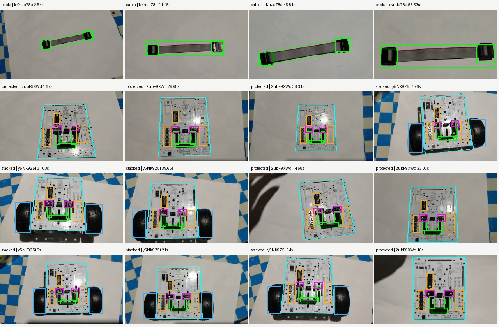

# Phase 10 room-lighting scan follow-up — October 25, 2026

## Scope and evidence

Investigated the actual pixels in `kKnJe78e.mp4` (data cable),
`2ubF9XWd.mp4` (protector sub-assembly) and `y5NK9Z5i.mp4` (stacked chassis).
The original matcher reproduced failures in all three positive-view groups.
The original board-only negative correctly failed stacked-assembly verification.

Added 16 reviewed, real JPEG keyframes (1,068,766 bytes) to packaged Phase 10
`var_light/` folders. Each has a timestamp, SHA256, sharpness measurement, body,
identity, context and hardware masks in `tools/phase1011_video_manifest.json`.
The 36 previously published Phase 10/11 reference JPEG hashes remain identical.
The reviewed video bank now contains 52 references; this is not the count of the
entire application library.

Thirteen new held-out frames cover four full views of each target and one clipped
cable view. New training/held-out timestamps are separated by at least two seconds.
All 38 Phase 10/11 replay JPEGs are retained in `tools/replay_fixtures/phase1011/`,
outside the production APK. No synthetic training pixels or invented underside
labels were added. JPEGs are sampled at the tablet scale; CLAHE remains symmetric
in the actual descriptor preparation and live-frame pipelines.



## Changes

- `Phase10ReferenceMatcher`: separates board, protector and tire descriptor pools
  before live-match deduplication; proposes a bounded dense live sample and a
  protector crop when needed. Every photo path retains the existing Lowe/Hamming,
  independent inlier, spatial coverage and board/part coherence gates.
- `Phase1011DescriptorSampler`: adds intermediate hardware scales for tablet-resolution Phase 10 references,
  independent protector/tire sampling and actual wheel masks. The audit exposed
  wheel regions that existed in metadata but were absent from the allowed pixel
  mask. Board context now includes distributed rigid PCB features while the open
  protector aperture is explicitly excluded from protector identity. The existing
  2,400-row cap per photometric variant remains. Phase 11 keeps its previous scales.
- `Phase1011VideoReferences`: generated annotations include the stacked role and
  share the same asset files with the unified catalog. Descriptor revision 6
  invalidates the affected reviewed-video cache entries.
- `RibbonCableGeometryVerifier`: after photo matching is attempted, a scoped
  fallback requires a continuous flat ribbon, both widened connector housings,
  consistent body width and a distributed red edge stripe. A cropped connector
  cannot complete the scan. This fallback describes the supplied kit cable;
  reference-photo matching remains available for other appearances.
- `MountedHardwareGeometryVerifier`: after distributed board photo verification,
  complementary checks require a connected U-frame, open aperture, both metallic
  mounting heads, or both rounded tire footprints with interior tread edges.
  Local contour refinement handles raised-frame parallax when necessary.
- `DetailSamplingSchedule` integration: a complete fresh observation holds the
  working photometric setting for the second confirmation frame. Two misses or a
  stage change release that hold. Previous acceptance is never reused as evidence.
- `ComponentRecognizer` and `AssemblyVisionAnalyzer`: supply RGB only for the
  loose-cable stage and reuse it for diagnostic captures. Other Phase 10 stages
  continue using gray frames. `LoosePartShapeRecognizer` shares the cable verifier
  with the individual tool after its photo path.
- Native matrices, temporary views and cached part-row owners are explicitly
  released. The existing bounded reference preload policy and separate low-latency
  outline tracking remain active. The loose cable retains its original coarse ORB settings; assembly targets use
  the fine body extractor. Temporary diagnostic tracing was removed.
- The long-run regressions exposed a Phase 7 scheduling bug: board-only proposals
  could replace the template that had verified both trackers and the caster.
  `Phase7ReferenceMatcher` now retains a separate preferred assembly template,
  gives it first opportunity to reverify the next frame, and releases that
  preference after two misses or a stage change. Each sensor's actual winning
  crop and source template are retained as search inputs for confirmation; tighter
  inferred crops had changed CLAHE tiling and effective feature scale immediately
  after success. One bounded extra ROI attempt reserves work for the second
  required sensor. No old observation or pose can
  count toward completion; both sensors, distinct mounts and the caster still
  need their own fresh evidence.

`OrbMatchPolicy`, `VerifiedScanEvidence`, `DynamicComponentOutlineOverlayView`,
`OpticalFlowTrackerBridge` and `TargetBoundingTracker` were not changed. Shape or
hybrid results report `COLOR_SHAPE_FALLBACK`; geometric evidence is not converted
into fake ORB match counts, perfect ratios or a calibrated 3D pose.

## Workflow and preservation

The 15-screen Phase 10 state machine, demo/scan isolation, two consecutive fresh
confirmation requirement, rescan controls and physical checklists remain intact.
No activity is launched by these offline replay tests. The replay adapter uses
only the static image helper; constructing the progress-resetting replay harness
is deliberately avoided.

Photos and these geometry checks can verify visible structure and placement.
They cannot measure hidden nut torque, standoff engagement or cable contact
pressure. Existing mandatory physical checks retain those responsibilities.

No main-app install, uninstall, data clear or preference reset is part of this
work. The extracted references live inside the project/app assets; runtime
recognition does not read the MP4s in Downloads. Original clips are useful only
for future authoring or re-ingestion.

## Verification procedures

Completed October 26: **710 host tests and all 64 native regression groups passed**
on the frozen candidate. The formerly intermittent Phase 7 sequence also passed
three independent targeted runs. Android lint reports **0 errors / 193 warnings**,
matching the prior warning count. The four progress/preference/database hashes
are byte-identical before and after testing. Production DEX and reviewed image
bytes in the tested candidate match the built ARM64 APK.

[Exact outputs, candidate hash, progress hashes and native case ledger](PHASE10_ROOM_SCAN_FOLLOWUP_VERIFICATION_2026_10_26.txt)

```powershell
powershell -NoProfile -ExecutionPolicy Bypass -File tools/build_tablet_debug.ps1
python -B tools/run_host_tests.py
python -B tools/ingest_phase1011_videos.py --verify
python -B tools/prepare_candidate_replay.py
# Push candidate-code.zip to the authorized tablet, then run one runner at a time:
powershell -NoProfile -ExecutionPolicy Bypass -File tools/run_quality_replay.ps1 -Suite phase10followup
powershell -NoProfile -ExecutionPolicy Bypass -File tools/run_quality_replay.ps1 -Suite all
```

The seven follow-up groups require two successful frames with four measured corners,
exercise measured LK motion after localization, reject the real clipped cable and
top-board-only views, and verify that both cable camera paths publish
an outline before the result. The assembly test also checks RGB delivery and the
two-frame gate through the actual YUV analyzer adapter. Legacy Phase 10 replay
now supplies RGB like the production camera rather than exercising only the
gray-only photo adapter. Existing cross-phase tests cover missing hardware,
orientation rejection, honest telemetry, startup, memory ownership and pause/resume.

Final outputs and preservation hashes are recorded in the accompanying verification
text file. An earlier overlapping-run attempt was discarded and rerun serially;
its interrupted results are not counted as validation.
