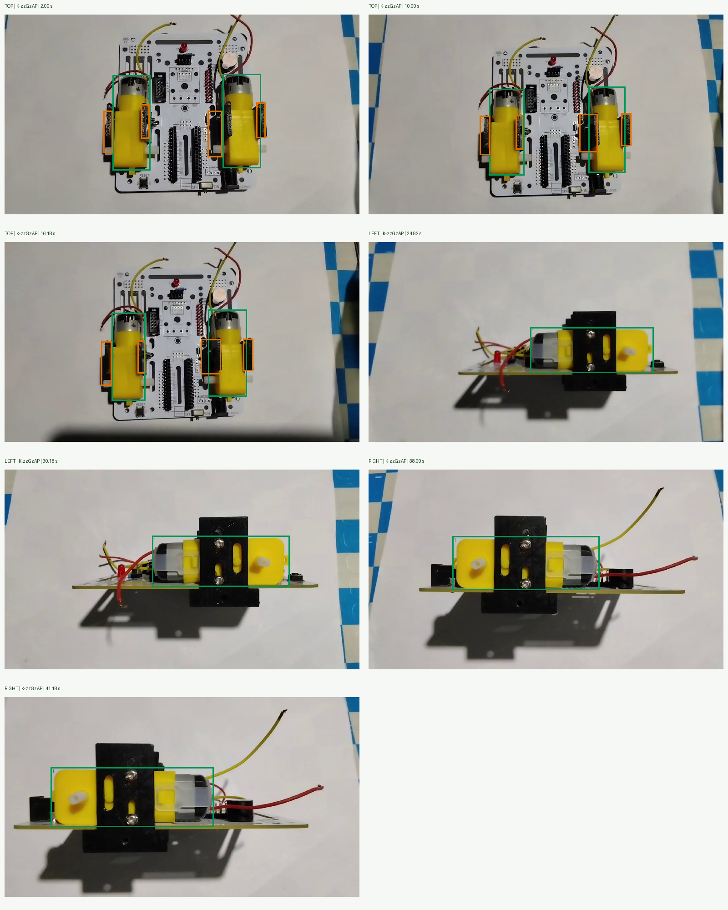

# Phase 1/2 raw-video recognition repair — 24 October 2026

## Scope and evidence

This follow-up uses the four raw camera clips supplied for the other room:
`UZLNjaoq.mp4` (bare board), `pETy-FHZ.mp4` (four brackets),
`b189KSO5.mp4` (two loose motors), and `K-zzGzAP.mp4` (installed top/left/right).
The videos were inspected as images, including blur, reflections, nearby leads,
the silver motor cans and the transitions between requested views.

There are **27 new packaged JPEG references, 1,463,891 bytes in total**. The original
desk references remain registered. These additions are real video pixels, not
rendered or AI-generated training images. The app reads its own packaged assets;
it has no runtime dependency on the Downloads videos.

| Role | References | Reviewed source times (seconds) |
|---|---:|---|
| Phase 1 bare board | 3 | UZLNjaoq: windows around 4, 12, 23 |
| Isolated bracket front/braced faces | 8 | pETy-FHZ: 2 and 11.82; four crops per frame |
| Four-bracket groups | 3 | pETy-FHZ: 2, 11.82, 27 |
| Isolated motor faces | 6 | b189KSO5: windows around 0.6, 17, 31; two crops per frame |
| Installed top | 3 | K-zzGzAP: windows around 2, 10, 16 |
| Installed left motor body | 2 | K-zzGzAP: windows around 25, 30 |
| Installed right motor body | 2 | K-zzGzAP: windows around 38, 41 |

`tools/phase12_video_manifest.json` contains each exact selected time, source,
sharpness, SHA256 and authored coordinates. The ingestion tool selects the sharpest
of three nearby frames only within explicitly reviewed windows. The oblique bracket
group at 27 seconds was selected explicitly to retain its specular braced faces.

The 18 replay frames use **different timestamps**: board 7/18/29, brackets 8/21/28,
motors 14/19/35, top 6/13/18, left 23/28/33, right 37/40/42. They are not registered
as templates. These are temporally separated same-video regressions, not an
independent recognition-rate study or proof of performance in every room.

## Hardware regions



Green regions contain the rigid TT motor gearbox/can/shaft. Orange regions contain
the four actual mounting bracket faces. Top verification requires both motor zones
and all bracket checks. Each side view uses its visible motor body, not the entire
mainboard or a tabletop/shadow rectangle. Region coordinates belong to each photo;
automatic yellow segmentation must not replace the reviewed coordinates.

## Defects found and changes

1. **Incorrect automatic top masks.** Some yellow masks included shafts or nearby
   PCB features and shifted the bracket bands onto unchanged board printing.
   `Phase2PhotoGeometry` now respects explicitly authored regions and captures the
   existing appearance checks from those exact bands. Legacy geometry stays intact.

2. **Reflective faces missing from inventory evidence.** Only the matte faces could
   survive the ordinary silhouette/ORB path in some frames. The reviewed front,
   braced and oblique lighting photos add the actual missing appearance coverage.
   A group photo can count four brackets only with a RANSAC consensus of at least
   16 inliers/50% ratio and separate six-inlier/spatial-spread support at every bracket.
   The final reprojection tolerance remains **3.5 pixels**. Exploratory extra crops,
   a different sampling path and a looser tolerance did not resolve the native failure;
   they were removed rather than retained as unused code or weaker gates.

3. **Repeated work before displaying an outline.** Distinct strong homographies from
   the initial ORB pass are retained before searching masked frames again. Candidates
   below the existing 0.75 instance-confidence threshold do not stop that search.
   The unconditional extra Phase 2 inventory scene pass was removed. A targeted
   four-bracket photo fallback runs only while the set is incomplete and does not
   override an identified conflicting component or an ambiguous identity. It reuses
   captured live descriptors instead of extracting a second full-frame ORB set.

4. **Partial sets pinned the wrong illumination path.** Seeing two or three brackets
   was treated as a successful lighting profile. Phase 2 loose inventory now continues
   the existing automatic normal/recovery selection until the requested set is present.
   Other phase preprocessing policies and all recognition thresholds remain intact.
   The proven shared CLAHE and recovery pipeline is retained; this repair does not
   replace every reference descriptor with a new global gamma/CLAHE baseline.

5. **Unnecessary negative matching work.** A bare-board reference cannot establish
   absence while TT housings are visible. That unused full BF pass is skipped in this
   case; missing motor/bracket regions still fail their independent installed gates.
   Existing bounded scheduling and measured LK updates continue during heavy matching.

6. **Phase 1 developer Skip entered a nonexistent demo chapter.**
   `PhaseAssemblyController.devSkipCurrentStep()` now uses Phase 1's existing developer
   completion path, making its real footer Next control available. This developer
   transition does not fabricate a camera observation or learner completion record.

The existing dynamic overlay, `OpticalFlowTrackerBridge`, `TargetBoundingTracker`
and global component registry have not been replaced. The analyzer still publishes
visual localization before workflow completion, then keeps tracking under the new
completed-step token without emitting another verification event.

## Files

- New: `camera/Phase12VideoReferences.java`, the 27 JPEG assets,
  `tools/ingest_phase12_videos.py`, `tools/phase12_video_manifest.json`.
- Catalog integration: `Phase2AssetCatalog`, `AssemblyProgressReferenceCatalog`,
  `VisionReferenceFactory`, `UnifiedReferenceCatalog`. Nested `var_light` discovery
  uses the existing recursive catalog and existing preload/cache ownership.
  Isolated crops remain individual components even though their parent folder is
  Phase 2; diagnostic requests for those crops must not invoke installed-top scanning.
- Runtime: `Phase2PhotoGeometry`, `Phase2ReferenceMatcher`, `ComponentRecognizer`,
  `AssemblyVisionAnalyzer`, `PhaseAssemblyController`.
- Tests: `Phase12VideoReferencesTest`, `Phase2AssetCatalogTest`,
  `Phase12VideoReplayInstrumentedTest`, `DynamicOutlineUiInstrumentedTest`;
  runner updates in `tools/run_host_tests.py` and `tools/prepare_candidate_replay.py`.
- Optional per-region diagnostics use the `AssemblArPhase2Roi` log tag at DEBUG.
  It is disabled for ordinary use; no per-reference strings are built unless enabled.

## Verification

The arm64 app and Android test APK build successfully. **401 host tests pass.**
Native candidate replay runs built code and the new small assets on tablet
`368e278b` / model `2603ARP14G`. It does not install the main APK, clear app data,
or reset assembly progress. The separate runner reports one outer JUnit invocation;
named `CandidateReplay` PASS entries identify the actual fixture groups.

Final candidate code/archive SHA256:
`1041da7bf58adb85a59495808cdf3b477fcc82167e08aac7f34a1bd5a45302b0`.

All four new raw-video/UI fixture groups pass:

- All 16 clear positive samples are recognized: three bare-board, two four-bracket,
  three two-motor and eight installed views. The bracket frame at 21 seconds retains
  partial 3/4 evidence; the blurred/hand-occluded left transition at 33 seconds cannot
  certify the requested view.
- The three top samples have two separately tracked motor outlines; clear side
  samples have their visible motor outline. Every accepted installed sample survives
  a measured LK pan check. The shared loose-part analyzer publishes an outline even
  when recognition succeeds on its first attempt.
- Three actual bare-board frames cannot pass installed top verification. Erasing
  any one of four physical brackets cannot produce a complete four-bracket inventory
  across three normal/recovery attempts per control.
- The Phase 1 developer completion state exposes an enabled, visible Next footer
  and its callback without opening the camera-evidence gate.

Final combined run: loose-frame analyzer timings **416–1,738 ms**; accepted
installed-view attempts **572–1,815 ms**. The first left frame needs a second automatic attempt.
These are replay attempt timings, not live-camera FPS, total user scan latency, or
uniform cold-start guarantees. An earlier passing raw run measured 386–858 ms for
loose frames and 591–1,288 ms for accepted installed attempts. Other earlier runs
varied up to multi-second timings under continued device load. All failures and
timings remain in `app/build/tmp/phase12-raw/`.

All **18 legacy regression groups also pass**, for 22 named native fixture groups
in total. They cover the bounded full catalog, twelve normal/dim/bright/side-gradient
checks, top-vs-side rejection, missing motor/bracket controls, 180-degree rotation,
collapsed/mirrored planes, four-vs-three bracket counting, wrong slot/color/identity,
original motor photos, sparse delayed LK, separate moving pair outlines, 220 buffer
reset/release cycles, stale detection results and outline delivery before/after the
completion-token change. These results are recorded in `native-final-baseline.txt`
and `native-final-baseline-events.log`. After the final catalog correction, **all
22 groups pass again in one run**, recorded in `native-final-all.txt` and
`native-final-all-events.log` (120.155 seconds total fixture runtime). This is not
a multi-hour memory/thermal soak.

## Reproduce and deploy

From this repository's Gradle root (`app/`):

```powershell
powershell -NoProfile -ExecutionPolicy Bypass -File tools/build_tablet_debug.ps1
python tools/run_host_tests.py
python tools/prepare_candidate_replay.py
```

To regenerate only the reviewed references (requires OpenCV, NumPy and Pillow):

```powershell
python tools/ingest_phase12_videos.py --opencv-path app/build/tmp/cv-test-deps --source-dir "C:/Users/Hem Bendijo/Downloads"
```

Replay fixture groups:

```text
vision.Phase12VideoReplayInstrumentedTest#reviewedBracketPhotosCannotCreateAMissingFourthPart
vision.Phase12VideoReplayInstrumentedTest#rawBoardBracketsAndMotorsUseTheSharedCameraPipeline
vision.Phase12VideoReplayInstrumentedTest#rawInstalledTopLeftRightRequireHardwareAndKeepOutlines
DynamicOutlineUiInstrumentedTest#phaseOneDeveloperCompletionShowsAnEnabledFooterWithoutCameraEvidence
```

Raw heldout JPEGs must be copied to the target app's external-files
`phase12-raw/` directory before replay. They remain test inputs, not app assets.
`tools/prepare_candidate_replay.py` supplies the candidate DEX/resources and the
small `VIDEO_` additions to the installed separate test runner.

Example native replay invocation (substitute the connected tablet serial):

```powershell
adb -s 368e278b push app/build/tmp/tablet-audit/candidate-code.zip /sdcard/Android/data/dev.chyken.assembl_ar/files/candidate-code.zip
adb -s 368e278b shell am instrument -w -r -e class dev.chyken.assembl_ar.CandidateCodeReplayInstrumentedTest -e candidateDex /sdcard/Android/data/dev.chyken.assembl_ar/files/candidate-code.zip -e candidateCases vision.Phase12VideoReplayInstrumentedTest#rawInstalledTopLeftRightRequireHardwareAndKeepOutlines dev.chyken.assembl_ar.test/androidx.test.runner.AndroidJUnitRunner
```

Deploy the **main app through Android Studio, preserving data**, as requested.
Then check Phase 1 board/Skip, Phase 2 four brackets/two motors, and installed
top/left/right in both rooms. Pan after success: the measured component outlines
should follow the object, including when Next has unlocked. Severe blur or a fully
occluded motor must remain unverified. A photo cannot prove screw tightness;
the existing explicit physical checklist remains required.
