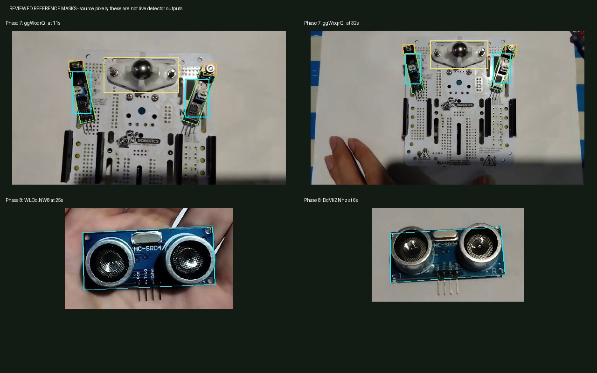

# Phase 7–9 scanning follow-up — 25 October 2026

## Result and scope

The supplied bottom-view tracker footage and loose distance-sensor footage now
pass tablet-native replay with **two consecutive successful frames**, with
measured outlines returned even on fast recognition. Phase 9 again starts with
the **loose standoff scan**. Its separate installed-standoff scan is removed from
the normal workflow; the final scan still requires **both wheels and the center
standoff**, followed by the physical stability checklist.

Verification: **710 JVM tests passed; all 57 native test groups were verified**.
The initial 56-group run had 55 passes and one process interruption. Android
recorded `SwipeUpClean` for that process, without an app crash trace. The affected
direct-replay/close race then passed three consecutive reruns. A final additional
Phase 8 camera-analyzer integration test passed. The test-only addition did not
change production DEX, resources, references or replay pixels. Original and
resolved result ledgers are retained separately; the interruption is not hidden.

## Recording review and packaged data

The new Phase 8 recordings show the **loose front face**, not an installed sensor.
The new Phase 7 recording shows the bottom PCB with independently angled trackers,
strong shadows and glare on the trim-pot screws. These were treated as separate
recognition problems.

| Recording | Reviewed recognition frames (seconds) | Held-out checks (seconds) |
| --- | --- | --- |
| `ggWoqrQ_.mp4` | 8, 11, 17, 32, 49, 67 | 14, 36, 58, 73: dual trackers plus caster |
| `WLOolNW8.mp4` | 4, 25 | 8, 18, 29, 35: sensor on a palm |
| `DdVKZNhz.mp4` | 6, 20, 35, 58 | 13, 28, 40, 61: sensor on paper; 49: incomplete/out-of-frame rejection |
| Existing `Zi6cD-KG.mp4` | Added 20 and 46; retained 10 and 38 | 42: clear standoff; 15: blurred/obscured view remains unverified; 70/90: wheel-hub rejection |

Fourteen real JPEG references were added, totaling **1,090,880 bytes**. There are
58 reviewed Phase 7–9 references in the manifest. The 42 tracked baseline JPEG
hashes remain unchanged. No synthetic component images were generated.

Portrait footage was rotated losslessly into landscape axes. The 11-second
tracker reference also uses a recorded 640-pixel sampling transform to represent
the tablet's image sampling. Other image processing remains in the existing
symmetric reference/live descriptor preparation path. Masks, source timestamps,
dimensions, transforms, sharpness and SHA256 values are recorded in
`tools/phase789_video_manifest.json`.

New-room replay timestamps are at least two seconds away from recognition frames
in the same recording. These are same-recording regression checks, **not an
independent accuracy study or a guarantee for every lighting condition**.



The figure shows authored reference masks, not live detector output. Tracker
bodies are green, mounting points orange, rigid identity regions cyan, and the
caster yellow. Recognition JPEGs contain no annotation graphics.

## Vision changes

**Phase 7:** Body identity now includes the sensor-head/control-PCB area in the
new views, rather than relying on the reflective trim-pot screw alone. Local
sampling includes the missing 192-pixel intermediate scale. Duplicate searches
over an already located body are skipped, and candidate scheduling retains a
rotating alternative. Both tracker bodies, their two distinct board mounts and
the caster must still be verified in the current frame. Matches are never
accumulated from separate one-tracker frames.

Testing exposed a stability bug beyond reference coverage: switching detail scale
and lighting-recovery mode immediately after a valid match could lose the next
confirmation frame. `DetailSamplingSchedule` now retains the successful settings
while continuing fresh recognition. Two misses or a stage change release the
settings. It stores configuration only, not prior acceptance evidence.

**Phase 8:** Loose-sensor recovery now samples the component locally. Dark-body
windows and the existing RGB sensor-body locator propose crops; those proposals
cannot complete a scan. Reference-to-live ORB and geometric verification remain
mandatory. The analyzer supplies RGB for the loose scan and reuses it for an
optional diagnostic capture, avoiding a second allocation. The installed scan
retains its separate sensor/board evidence and outward/inward rejection rules.
The successful lighting-recovery setting is also retained across fresh sensor
confirmation frames. Existing 10-wire instructions remain unchanged.

**Phase 9:** The user explicitly approved photo matching plus a geometric verifier
for the texture-poor reflective standoff. Photo matching runs first. If it cannot
establish the loose part, the fallback requires a complete elongated shaft,
consistent body width, brass distributed along the body, and a widened shoulder
with a narrower threaded end. Clipped shapes and yellow wheel hubs are rejected.
The result is labeled `COLOR_SHAPE_FALLBACK` with a shape reference ID; it does
not fabricate ORB matches, match percentages or calibrated TRE. The same fallback
is available in the Individual Component Tester. The final combined assembly
scan does **not** use this loose-part fallback.

`OrbMatchPolicy` and `VerifiedScanEvidence` were not relaxed or edited for these
fixes. Dynamic overlays, LK tracking, the global registry, existing illumination
normalization and the bounded descriptor cache remain active.

## Phase 9 navigation and persistence

The nine-screen sequence is now:

1. Scan loose standoff.
2. Confirm nut and screwdriver preparation.
3. Scan both loose wheels.
4. Confirm wheels ready.
5. Watch/skip the standoff installation demo.
6. Complete the lower-nut and saved-top-screw physical checks.
7. Watch/skip the wheel installation demo.
8. Scan both installed wheels **and** the center standoff.
9. Confirm wheel stability before continuing to Phase 10.

The standoff demo uses **Ready for Checklist**; the wheel demo uses **Ready to
Scan**. Playback does not navigate automatically. Rescan remains guarded by
completion. Snapshot version 3 migrates versions 1 and 2 by screen meaning rather
than ordinal. Existing later progress is retained without forcing learners to
disassemble an installed standoff merely to repeat earlier inventory gathering.
The legacy installed-standoff matcher remains for compatibility and replay; the
new workflow never requests its stage 3 scan.

No progress-store keys or database schema were changed. On-device hashes of
assembly progress, guided steps, UI preferences and the database were identical
before and after testing. Migration behavior was unit-tested; the main tablet
APK was not replaced during these offline tests.

## Main files

- `Phase9StandoffWheelsFlow.java`, `Phase9GuideController.java`: revised sequence,
  versioned checkpoint migration, labels and explicit preview destinations.
- `Phase7ReferenceMatcher.java`, `ReviewedHardwareDescriptorSampler.java`,
  new `DetailSamplingSchedule.java`: local sampling and fresh-frame stability.
- `Phase8ReferenceMatcher.java`, `ComponentRecognizer.java`,
  `AssemblyVisionAnalyzer.java`: local sensor recovery and RGB proposal plumbing.
- `Phase9ReferenceMatcher.java`, new `StandoffGeometryVerifier.java`,
  `LoosePartShapeRecognizer.java`: photo-first loose-standoff fallback and outlines.
- Generated `Phase789VideoReferences.java`, ingestion script, manifest and 14
  JPEGs: reviewed real-pixel reference integration.
- `Phase789FollowupReplayInstrumentedTest.java`, updated replay/navigation/catalog
  tests, and `DetailSamplingScheduleTest.java`: new regression coverage.
- `prepare_candidate_replay.py`, `run_quality_replay.ps1`: persistent replay
  fixtures and the nine-group `phase789followup` suite.

All added native buffers are released in `finally` blocks. Local search windows,
candidate work and descriptor counts remain bounded. No reference-file reads were
added to the live frame matchers. The approved bounded-RAM caching policy remains
in place.

## Reproduction and deployment

From the Gradle project directory:

```powershell
powershell -NoProfile -ExecutionPolicy Bypass -File tools/build_tablet_debug.ps1
python -B tools/run_host_tests.py
python -B tools/ingest_phase789_videos.py --verify
python -B tools/prepare_candidate_replay.py
adb -s 368e278b push app/build/tmp/tablet-audit/candidate-code.zip /sdcard/Android/data/dev.chyken.assembl_ar/files/candidate-code.zip
powershell -NoProfile -ExecutionPolicy Bypass -File tools/run_quality_replay.ps1 -Suite all
```

The full suite now contains 57 groups. The existing isolated test runner must be
installed and the tablet authorized. Keep the app out of the recent-app cleaner
during instrumentation. Native coverage includes missing/wrong parts, inward
sensor placement, Phase 2 hardware completeness, Phase 3/5 orientation, Phase
10/11 assembly checks, fast outline delivery, moving pairs, delayed detector
results, 3,000 tracking frames, lifecycle ownership and authentic diagnostics.

Build succeeded; Android lint reported **0 errors and 193 warnings**, matching the
previous warning count. Exact verification evidence is summarized in
`PHASE789_SCAN_FOLLOWUP_VERIFICATION_2026_10_25.txt`.

Deploy the app normally through **Android Studio**, retaining app data. No uninstall
or data clear is needed. Recognition JPEGs are copied into the app's local assets;
the application does not read the Downloads MP4s. Forty-three held-out JPEGs are
also retained under `tools/replay_fixtures/phase789` for repeatable native tests
after deleting source videos. These test fixtures are excluded from the production
APK. Original MP4s are needed only to regenerate or extend the dataset.

Automatic approval review rejected a geometry-first optimization because it could
bypass photo evidence. The implemented standoff path retains photo checks first
and then the user-approved geometric fallback.
