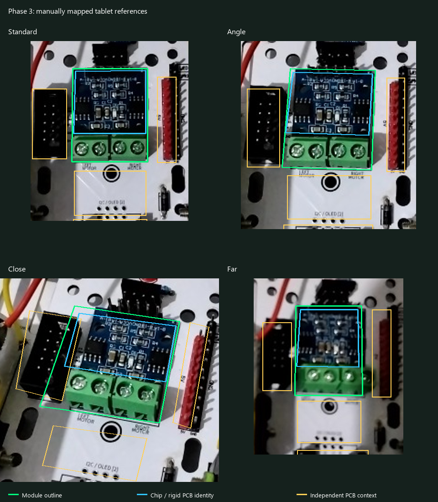
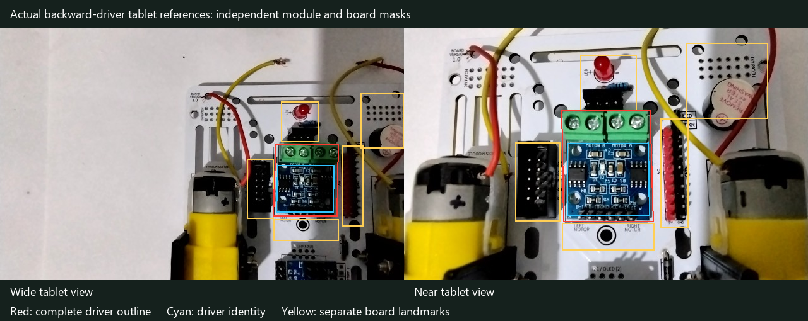

# Component lock-on and material robustness repairs — 24 October 2026

## Production changes

### Successful scans keep their outlines

`PhaseAssemblyController` retains a visual request for the current scan generation.
`CameraTrackingPolicy.retains` keeps visualization separate from accepting workflow evidence.
A successful scan can continue receiving LK updates until navigation, replay, hardware
preparation, or an interrupted capture window invalidates that request. Visual-only
frames never advance a step or add benchmark trials. The retained request receives
the current frame's camera calibration.

`ImageOutlineTracker` attempts denser Shi–Tomasi seeds for small/dark components,
retaining the same forward/backward LK and RANSAC motion checks. A fresh measured
ORB polygon can be displayed even if the body cannot seed LK; unsupported geometry
expires rather than staying fixed to the screen. A delayed detector may add another
component to an existing tracked set, subject to relocation against the latest image.

Assembly analysis explicitly requests the supported 640×480 buffer, with the existing
PreviewView crop. This avoids a lower-resolution fallback. It does not request HD.

### Local component sampling

`ComponentDetailExtractor` owns short-lived bounded ROI samples. It uses native pixels
and optional enlargement capped at 4×, with low-edge-threshold ORB and the existing
CLAHE/illumination recovery path. A board homography only proposes the search region;
fresh component correspondences must still pass independent geometry checks.

- **Phase 3:** native/detail driver sampling, rotating fallback viewpoints so new wire
  and lighting photographs are not starved by a constant top-four candidate list.
  Driver and PCB homographies remain separate. Missing/reversed modules cannot pass
  using unchanged board printing.
- **Phase 7:** grayscale proposals no longer require blue pixels. Located instances
  are masked out before the next local Lowe test. Short-lived ROI hints prioritize
  searches without accumulating recognition counts. A small descriptor probe ranks
  viewpoints; only full local matching, RANSAC, identity coverage and distinct mounts
  accept a module. Probe work is included in matching time, but is not substituted
  for diagnostic good/total match statistics.
- **Phase 8:** independent PCB geometry can recover a sensor detail search when
  whole-frame matching loses the reflective transducer features. The valid, missing
  and inward-facing reference families retain their separate classification gates.
- **Phase 9:** an independent local standoff homography can supply evidence when
  metallic reflections remove gold hue. Wheel searches retain neutral spatial
  alternatives when yellow hub color is unavailable. Enlargements are capped at 4×.
  Both installed wheels still need local evidence. Standoff and wheel observations
  carry separate outline regions. The prior removal of the loose-standoff scan remains.
- **Phase 10:** bounded detail proposals recover small cable/protector samples. The
  mounted protector requires two dark side rails relative to the PCB visible through
  its aperture, instead of a fixed global gray cutoff. Its verification outline follows
  the protector rather than the entire extension board.

All new native matrices are released or bounded by the active reference bank. The
earlier small individual-test bank, latest-only UI updates and shadow-free diagnostics
popup are retained. There are no new per-frame file reads or image exports in normal use.

## Phase 7 lifecycle change

1. Caster scan → separate screws/nuts preparation.
2. Two tracker scan → separate screws/spacers/nuts preparation.
3. Caster demos → explicit **Ready for Checklist** → sandwich/swivel answers.
   There is no installed-caster camera scan or Rescan button on this manual page.
4. Tracker demos → explicit **Scan Work** → combined bottom-view check of the caster,
   both trackers and two distinct board mounts → physical stability confirmation.

The final positive reference geometry includes an independent caster region. The
raised caster has its own local homography with placement coherence against the PCB;
it is not forced onto the flat-board pose. All three parts must be supported by a
single current frame/context hypothesis. The two sensors can swivel around their
mounts. Reflective nuts/fastener torque still require the explicit physical answers.

Snapshot version 4 accepts versions 1–3 and preserves completed hardware, demos and
physical answers. An old in-progress caster scan resumes at its checklist. The final
scan retains Previous → demo, replay, explicit Rescan and review controls. Project/DEV
sub-step descriptions use the revised flow.

## Verification

The APK and test APK build with:

```powershell
powershell -NoProfile -ExecutionPolicy Bypass -File tools/build_tablet_debug.ps1
python tools/run_host_tests.py
```

The host suite passed **391 tests**, including scan-generation visual ownership,
demo isolation, saved-state migration, hardware pages, replay/rescan and combined
caster/tracker evidence requirements.

Native OpenCV tests were run on tablet **368e278b / 2603ARP14G**, using the existing
separate test package and candidate-code replay. The main app was not installed,
uninstalled, reset or advanced by these offline fixtures.

Passed named regressions include:

- Fast measured outline with insufficient LK corners; unsupported bounds expire.
- Adding a third confirmed region to an already moving pair.
- Shared analyzer scan → complete transition: outline delivered before completion,
  then follows a translated image without adding workflow or benchmark evidence.
- Native LK pan/occlusion rejection and separate moving pair outlines.
- Multi-second detector results are relocated against the newest measured image;
  an occluded target cannot resurrect an old polygon.
- Installed driver under shadow; missing and 180-degree reversed driver rejection.
- Installed distance sensor with a partial synthetic highlight; missing-sensor rejection.
- Inward-facing sensor installations rejected at camera scale, including rotated boards.
- Dark, achromatic tracker pair plus caster; removing the caster keeps the final scan locked.
- Identical tracker instances in normal, blurred, rotated and color-free frames;
  removing one module cannot count as two. After viewpoint prioritization, the first
  positive condition locked on the second attempt, the next three conditions on their
  first attempts. These timings are fixture observations, not universal room guarantees.
- Achromatic installed standoff; erasing it cannot pass using PCB printing.
- Cable and loose protector under darker/brighter exposure transformations.
- Bright mounted protector; actual bare extension PCB rejected.
- Front/back wheel hub faces; a single wheel cannot pass a two-wheel scan.
- Installed standoff and both wheels produce three outline regions; either missing
  wheel remains rejected.

An early combined-caster fixture failed and was used to correct the raised-caster
geometry and tracker viewpoint scheduling before the passing run. Synthetic exposure,
occlusion and translated-image checks are engineering regressions, not academic
accuracy, lighting-rate or mechanical-firmness measurements. Fixture elapsed times
include reference loading and multiple positive/negative trials.

## Live validation and raw captures

The inspected live Phase 3 screen showed an installed driver with no successful lock.
The developer frame exporter only contained an older Nano frame; that archive was
excluded as Phase 3 evidence. The new Phase 3 path supports the existing explicit
opt-in measurement flags so the actual analyzed pixels can be replayed:

```powershell
adb -s 368e278b shell setprop log.tag.AssemblArMetrics DEBUG
adb -s 368e278b shell setprop log.tag.AssemblArCapture DEBUG
# Capture a short burst while the intended scan is open; then disable both flags.
adb -s 368e278b shell setprop log.tag.AssemblArCapture INFO
adb -s 368e278b shell setprop log.tag.AssemblArMetrics INFO
```

Frames are under the app's external `files/measure/` directory. The native method
`MaterialRobustnessInstrumentedTest.recordedDriverPlacementMustMatchAndRetainAnObjectOutline`
accepts `phase3Frame` pointing to such an opt-in frame. It verifies a fresh placement
match and measured outline using the production matcher, without changing progress.

Deploy the main app through Android Studio with app data retained. Live confirmation
in the user's failing setup, and physical checks in the other rooms, remain distinct
from the offline photo regressions above. No claim of success in an unseen room is made.

### Follow-up: actual Phase 3.4 tablet session

The deployed `1.1.14-2bae6819a8-dirty` app was inspected with the seated driver in view.
All four activity samples over 18 seconds showed a locked outline (delivery ages
132, 58, 29 and 11 ms). Screenshots showed the polygon moving with the driver and
the visible **Next Step** button enabled. The process stayed alive; its memory high
water mark remained 465,844 KiB during this short observation. This is not a long soak.

The analyzed camera image was **640×400**, using `FOCAL_SENSOR_METADATA` calibration.
Its raw recognition log also exposed intermittent reacquisition: 14 expected results
and 62 no-component results among 76 recorded detector jobs, with median matching
time 2,008 ms. That mixed moving-camera burst is not an academic recognition-rate
measurement. A locked LK outline after one successful match did not prove that
subsequent independent detection was reliable. The captured close view reproduced
that failure in native replay, so the initial visible unlock was not treated as the
end of the repair.

The additional Phase 3 correction:

- Tries references acquired at the closest pixel scale first, then retains a
  previously successful view. Other viewpoints remain available.
- Uses an independent PCB homography to resample a bounded module search at reference
  scale/perspective. Fresh driver descriptors and an independent module homography
  must still pass the existing 8-inlier/distribution requirements; the board needs
  its separate 16-inlier proof. Resampling cannot substitute board texture for the
  module or force a reversed module into the correct orientation.
- Keeps local detail sampling bounded and releases every temporary native matrix.
- Adds four confirmed, correctly seated tablet photographs to the actual app assets
  under `references/Phase3/STEP3_5ASSEMBLYSCAN/TABLET_DRIVER_PLACEMENT*.jpg`. They cover
  different ranges/perspectives. Runtime uses the bundled files, not Downloads or a
  device capture folder. No global descriptor-pyramid change or all-phase cache
  invalidation was retained.

Reference provenance (app-private opt-in capture session `20261024-070930`):

| Bundled reference suffix | Source capture |
| --- | --- |
| `_20261024` | `741229867165968.jpg` |
| `_FAR_20261024` | `741189156495968.jpg` |
| `_ANGLE_20261024` | `741310043531906.jpg` |
| `_CLOSE_20261024` | `741359874501281.jpg` |

Separate held-out frames `741366970734510`, `741222861758468` and `741184232884093`
all passed on their first attempts in the final candidate replay, respectively
1,842, 394 and 2,095 ms total matcher time. Each also delivered measured outline
bounds. None is a bundled reference. These frames are from the same camera session;
they establish this setup's regression, not performance across independent rooms.
The exact-reference self-match used while diagnosing preparation was excluded from
those held-out results.

Orientation regressions explicitly passed:

- A held-out driver photo under shadow remains accepted; a synthetically reversed
  driver never passes and produces **BACKWARD**, rather than only remaining in search.
  Erasing the module cannot pass using the unchanged PCB.
- Three held-out, actual inward-facing distance-sensor reference photos, each viewed
  normally and with the whole camera image rotated 180°, produce **INWARD** and cannot
  unlock the installation scan. The existing separate board/sensor placement gates
  and outward-facing TTS correction remain connected.

The candidate archive includes the four small assets for isolated native replay;
large video/reference assets still come from the installed app. Opt-in capture and
trace flags were switched back to `INFO`. Main-app deployment remains through
Android Studio with app data preserved. Live verification of this final additional
correction requires that updated deployment.

## Manual Phase 3 adjustment and real backward-installation photographs

Seven actual reversed installations were subsequently supplied under
`references/Phase3/STEP3_1MOTORDRIVER_INVALID/`, named
`MOTORDRIVERWRONGORIENTATION (1).jpg` through `(7).jpg`. Inspection shows the green
motor terminals toward the red LED, with the driver's six-pin row toward the board
center. These are now explicit installed-step negative references. The existing
`MOTORDRIVER_BACK_INVALID/` underside photos remain scoped to the loose-part flip
check. `Phase3AssetCatalog.installed` centralizes that distinction in the active
bank, unified catalog, global registry, descriptor sampler and matcher.

### Authored regions and feedback

`Phase3ReferenceAnnotations` contains manually inspected polygons for all four
tablet reference views:

- A chip/rigid-PCB identity polygon, excluding the neighboring mainboard header.
- A separate complete module outline including the green terminal block.
- Independent stationary mainboard header/printing regions for placement context.
- Explicit visible mounting-hole centers to suppress glare features.



The descriptor mask, module/context split, pose projection and delivered outline
use these separate regions. The perspective view's polygons follow its slanted
PCB edges. The per-reference cache key changes for these four authored views;
unmodified phase/reference descriptor files retain their cache keys.

`Phase3ReferenceMatcher` always considers the actual backward-installation family.
A positive shortcut cannot bypass it. A negative photograph can supply rejection
evidence, but never supply a correct-placement confirmation. It still requires
independent module and PCB homographies; board-only evidence cannot pass.
The selected reference ID and selected state's polygon remain paired, so a warning
cannot accidentally display another candidate's outline.

Strong geometric displacement is now delivered as `MISALIGNED`, with its outline
and a HUD/TTS instruction to lift, align the header pins and re-seat the driver.
This state cannot unlock Next. The six-step workflow and saved progress format
are unchanged.

### Bounded work and verification

A cached 32-descriptor body probe ranks viewpoints. Full native verification visits
four ranked positive views, two ranked negatives, rotating alternatives, and the
last successful positive view. Other viewpoints remain available through rotation.
Only full Lowe/RANSAC geometry supplies evidence; probe counts never become reported
recognition matches or benchmark trials. Probe time is included in measured work,
and its native buffers are owned by the active bank and released on close.

On tablet `368e278b / 2603ARP14G`, candidate replay passed:

- Three actual backward-installation photos held out of the training bank, each
  viewed normally and after a whole-image 180-degree rotation: **6/6 BACKWARD** on
  the first attempt, with `WRONG_ORIENTATION` and a measured four-corner outline.
- Three separate correct-placement camera captures, with the new negative family
  loaded: **3/3 PLACED** on the first attempt and measured outline delivery.
- On each of those actual captured images, a measured LK outline follows a synthetic
  24-pixel horizontal / 12-pixel vertical pan within 3 pixels. It remains measured,
  rather than a screen-fixed predicted polygon, after recognition success.
- Held-out correct driver under shadow, synthetic reversed-driver correction,
  and missing-driver rejection.

The initial exhaustive implementation took 2.59–8.32 seconds for the six actual
backward views. The final bounded implementation measured **0.51–0.82 seconds**
on those same replay conditions; correct camera captures measured **0.59–0.81
seconds**. These are matcher-call timings on saved frames, excluding camera startup
and UI delivery, and are not academic accuracy or unseen-room guarantees.
Repeating the correct-frame cases with the pan regression measured 0.61–1.02 seconds.

The debug app and native fixtures build successfully. **394 host tests** pass,
including negative-reference scoping, correct/reversed/camera-rotated geometry,
misaligned feedback classification, authored identity/context separation and the
existing cross-phase workflow checks. Run the build/host commands above; native
cases are in `MaterialRobustnessInstrumentedTest`:

```text
actualBackwardDriverPhotosRejectAtTabletScaleAndCameraRotations
recordedDriverPlacementMustMatchAndRetainAnObjectOutline
installedDriverKeepsOrientationUnderShadowAndRejectsMissingDriver
```

The candidate archive includes the seven new images for native testing before main
app deployment. They are normal project assets and will ship in the app. The main
app has not been installed or reset by these tests. Deploy the latest source via
Android Studio, preserving data, and use **3.4 → Rescan this step** for live
confirmation in the current physical setup.

## Follow-up: actual backward-driver camera session, 2026-10-24

The next live deployment did **not** produce the expected correction. Ten opted-in
640×400 camera frames from `measure/20261024-134942` showed `SEARCHING`, with Next
locked. The saved-phone-photo regressions above did not establish live recognition
of this setup. This follow-up records that failure explicitly.

Inspection found insufficient independent PCB context at tablet scale, especially
when the lower Nano socket was occupied and when the camera approached the driver.
The driver itself could match while the board homography failed its 16-inlier gate.

Two frames became calibration assets, copied into the project negative family:

| Asset | Calibration camera frame |
| --- | --- |
| `TABLET_DRIVER_BACKWARD_WIDE_20261024.jpg` | `765198238355080.jpg` |
| `TABLET_DRIVER_BACKWARD_NEAR_20261024.jpg` | `765204805878309.jpg` |

These two frames are **training data**, not held-out test successes. The seven
original phone negatives remain bundled, giving nine real backward references.
All six authored tablet views now have independent identity, outline, hole and
context masks. The new negative views use nearby LED/header/PCB landmarks and
exclude the lower Nano socket. Only authored-reference cache keys change.



`Phase3ReferenceMatcher` now supports bidirectional scale recovery. An independent
board homography can propose a resampled module window, as before. Conversely,
a measured module homography can propose normal/180-degree resampled **board**
windows. A proposal cannot pass the scan: fresh context descriptors still require
16 independent PCB RANSAC inliers, 50% consensus, and spatial spread; module
identity still requires 8 distributed inliers. Remote repeated-header matches
are excluded by a bounded search radius before context RANSAC. At most three
context recoveries are attempted per recognition call. Strong fresh positive
geometry avoids further context-recovery passes, while raw negative comparisons
remain enabled. All temporary native buffers are released.

Authored-reference preparation uses a 3,200-feature budget so PCB landmarks do not
lose their budget to dense driver traces. Both positive and negative candidates
are scheduled by the same cheap probe ranking; a clear negative no longer waits
behind four weak positive viewpoints. Probe matches remain scheduling only.

Native replay of the seven other visible camera views produced `BACKWARD`, never
acceptance, with a measured four-corner outline. On each, LK followed a synthetic
24×12-pixel image translation within 3 pixels. The eighth held-out frame,
`765210516180133.jpg`, has substantial finger obstruction and insufficient board
context: six fresh attempts remained `SEARCHING`, never an incorrect acceptance.
This is an explicit visibility limitation; the strict backward-correction test
initially failed on that frame and is not counted as eight successful warnings.
The dedicated obscured-view regression tests rejection separately.

Additional native controls cover three separate correct-placement tablet frames,
six real-phone backward/whole-camera-rotation cases, a held-out shadowed correct
installation, a synthetically reversed module, and an erased/missing module.
Main-app deployment is still performed by the user through Android Studio,
preserving app data. A live warning/outline and correct-placement Next-button
check remains necessary after deploying this follow-up source.

Final follow-up build: **BUILD SUCCESSFUL**; **394 host tests passed**. Both native
replay invocations completed successfully, covering all the cases above. The
outer generic runner reports one JUnit test per invocation; named `CandidateReplay`
entries identify each actual fixture, so this is not reported as a fabricated
number of independent academic trials. In the final run, matcher calls measured
0.85–1.62 seconds for the seven visible held-out backward camera frames and
1.59–2.11 seconds for the three correct-placement captures. These timings include
the added recovery work and vary with device load; they are not live end-to-end
latencies or a guarantee for other lighting. The obstructed frame still cannot
supply an orientation warning, and must not unlock Next.

All nine negative JPEGs were verified byte-for-byte inside the built APK. Frame
capture and measurement logging flags were returned to `INFO` after capture.
Detailed local outputs are under `app/build/tmp/outline-soak/phase3-deployment-*`.
